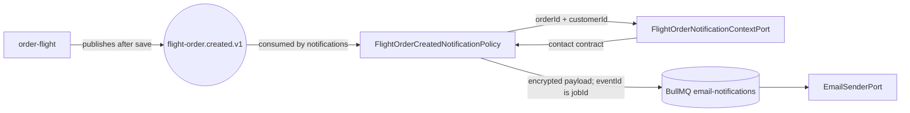

# Backend event map

Domain events communicate completed business facts between modules. Producers
do not import their consumers. Consumers subscribe to the public event
contract and handle failures independently from the original request.

| Event                         | Producer       | Consumers                | Status                                    |
| ----------------------------- | -------------- | ------------------------ | ----------------------------------------- |
| `flight-order.created.v1`     | `order-flight` | `notifications`          | Email job implemented; provider simulated |
| `flight-order.booked`         | `order-flight` | none                     | Producer implemented                      |
| `flight-order.booking-failed` | `order-flight` | none                     | Producer implemented                      |
| `flight-order.cancelled`      | `order-flight` | none                     | Producer implemented                      |
| `customer.created.v1`         | `customers`    | none                     | Producer implemented; identifiers only    |
| `customer.updated.v1`         | `customers`    | none                     | Producer implemented                      |
| `customer.status-changed.v1`  | `customers`    | none                     | Producer implemented                      |
| `customer.deleted.v1`         | `customers`    | none                     | Producer implemented                      |
| `payment.succeeded.v1`        | `payments`     | tour/flight order bridge | Awaited status update implemented         |

`flight-order.created.v1` contains identifiers only and carries no email,
name, phone or document data. The notification policy resolves the immutable
order contact through `FlightOrderNotificationContextPort`, which performs one
indexed read for this asynchronous event. Before persistence in Redis, the
complete email request is encrypted with AES-256-GCM. The email address is not
written to application logs. Queue jobs use the domain `eventId` as the BullMQ
`jobId` to suppress duplicate jobs while BullMQ retains the original job.

The current publisher uses in-process `EventEmitter2`. This first slice shows
the module boundary and asynchronous delivery worker, but it does not close
the process-crash gap between saving an order and adding its queue job. Before
production email delivery, persist the event to a transactional outbox in the
same database transaction as the order.

Event shapes come from `src/shared/events`; the synchronous notification
context comes from `src/shared/contracts`. The producer maps its `FlightOrder`
domain entity to the event contract, while notification consumers map that
contract to their own delivery command.
Consumers do not import the `order-flight` domain.

`payment.succeeded.v1` contains payable type/ID, provider payment ID, RUB
minor-unit amount and payment time. The payment service awaits its in-process
consumer before acknowledging a successful provider webhook. This preserves
normal webhook retries when a handler fails, but does not replace the
transactional outbox required for process-crash recovery.

Customer authentication uses a synchronous `CustomerAuthenticationContract`
containing `id`, `phone`, current first and last name and `status`.
`customer-auth` owns the reader port and a bridge maps the private customer
record to that contract. The
`customers/submodules/customer-travelers` submodule owns a
separate existence-check port and receives no customer profile data.
