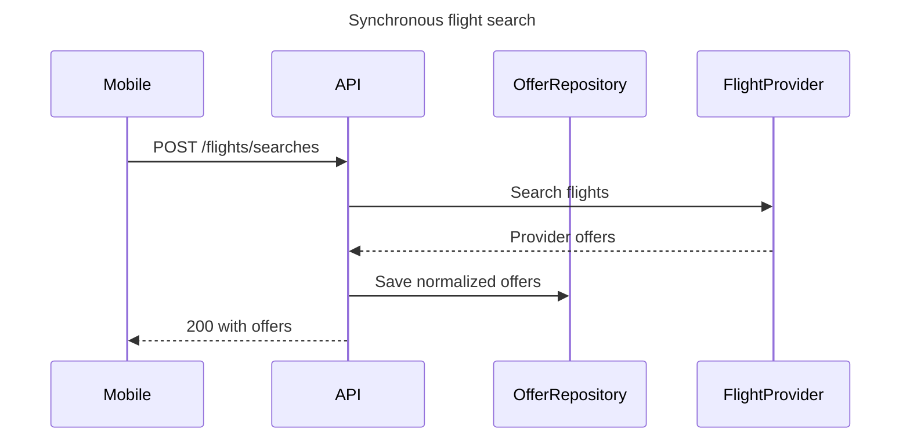

# Flight search module

The flight module implements synchronous provider-neutral flight search from
`docs/ttbooking-api.doc`. Its dependency direction is:

```text
mobile controller → application use case → FlightProviderPort
                                      ↘ MockFlightProvider | TtbookingFlightProvider
```

## API and orchestration

```text
POST /api/v1/flights/searches
GET  /api/v1/flights/offers/{offerId}
GET  /api/v1/flights/offers/{offerId}/fare-rules
POST /api/v1/flights/offers/{offerId}/share
GET  /api/v1/flights/shares/{token}
```

`SearchFlightsUseCase` validates input, awaits the configured provider,
normalizes and saves offers, and returns them in the same HTTP response. The
remaining use cases read an offer and fetch fare rules.
Controllers contain no orchestration.



Search validation requires at least one adult, no more than nine passengers,
infants not exceeding adults, different origin/destination codes, non-past
dates and chronologically ordered multi-city legs.

The search contract supports cabin class and backend post-processing filters:
`directOnly`, `preferredAirlines`,
`departureTimeFrom`/`departureTimeTo`, `arrivalTimeFrom`/`arrivalTimeTo`,
`maxStops`, `maxDurationMinutes`, `baggageRequired`, `minPrice` and `maxPrice`.
Time values use local `HH:mm`; a range whose start is later than its end wraps
across midnight. Until per-leg time filters are introduced, departure and
arrival time constraints apply to the outbound itinerary only; stop, duration
and baggage constraints still apply to every itinerary. `sortBy` accepts `recommended`, `price`, `duration` or
`departure`. Recommended order preserves the provider ranking.

Pagination belongs to `SearchFlightsUseCase`. `page` defaults to 1 and `limit`
defaults to 20 with a maximum of 50. On a cache miss the use case requests the
complete unfiltered provider result and stores it in Redis for five minutes.
Every request then filters and sorts the cached offers and returns only the
requested slice.

The search response also contains `meta.filters`, calculated from the complete
filtered result before pagination. It exposes the price range, stop-count and
validating-airline options with offer counts, baggage availability counts,
total-duration range and departure-time range. Clients must not infer filter
values from the current page.

`meta.highlights` contains the highlighted offer UUID, a stable `type` and an
already localized `label` selected from `Accept-Language`. The backend promotes
the cheapest offer first and the fastest distinct offer second before
pagination. If one offer is both cheapest and fastest, it receives both
highlights. Clients display these labels and do not calculate highlights. The
domain owns the stable highlight type and selection rules; the mobile API
entrypoint catalog owns localized presentation labels, which are applied by
`FlightApiMapper` rather than the controller or domain.

The cache key is a SHA-256 hash of routes, cabin class and canonically sorted
passenger groups plus the provider name. Filters, sorting, `page` and `limit`
are excluded, so changing result filters reuses the same raw provider response
instead of starting another TTBooking search. Cache hits receive fresh
ProTravel offer UUIDs for the requested page,
which are saved for revalidation and booking. Redis failures are handled as
cache misses and do not make provider search unavailable.
Empty cached arrays are treated as cache misses, and empty provider results are
not cached. This ensures that pull-to-refresh can retry the provider instead of
replaying an empty result for the full cache TTL. Search diagnostics record only
provider name, route/filter names and aggregate group/itinerary/offer counts;
provider tokens and raw response bodies are never logged.

The TTBooking adapter rejects response bodies larger than
`TTBOOKING_MAX_RESPONSE_BYTES` (10 MiB by default) before JSON parsing when a
valid `Content-Length` is present and verifies the actual byte length before
`JSON.parse`. Normalization is capped by `FLIGHT_SEARCH_MAX_OFFERS` (5,000 by
default). These bounds protect the Node.js event loop and Redis serialization;
payload size and parse latency should be monitored before introducing worker
thread parsing.

Calendar dates are represented by `LocalDateValueObject`, backed internally by
`@js-temporal/polyfill` and `Temporal.PlainDate`. The application obtains
today's date through the injected `ApplicationClock` in `APP_TIME_ZONE`
(`Asia/Tashkent` by default); use cases do not construct JavaScript `Date`
objects or derive calendar dates by slicing UTC timestamps.

Each business validation has a stable error code:

- `FLIGHT_SEARCH_ADULT_REQUIRED`;
- `FLIGHT_SEARCH_INFANTS_EXCEED_ADULTS`;
- `FLIGHT_SEARCH_PASSENGER_LIMIT_EXCEEDED`;
- `FLIGHT_SEARCH_SAME_AIRPORT`;
- `FLIGHT_SEARCH_DATE_INVALID`;
- `FLIGHT_SEARCH_DATE_IN_PAST`;
- `FLIGHT_SEARCH_DATES_NOT_CHRONOLOGICAL`.

The global error filter translates these codes using `Accept-Language`. Safe
structured context such as `routeIndex` or total passenger count is returned
in `error.details` for mobile form handling.

TTBooking tokens exist only in the internal `FlightOffer.providerReference`.
Public consumers receive ProTravel UUIDs and never depend on a provider token.

## Providers

Local development defaults to the deterministic `mock` provider. TTBooking uses:

```dotenv
FLIGHT_PROVIDER=ttbooking
TTBOOKING_BASE_URL=https://provider.example/flight-api
TTBOOKING_FARE_RULES_URL=https://provider.example/readFlightRules
TTBOOKING_AGENCY_ID=...
TTBOOKING_USER_ID=...
TTBOOKING_PASSWORD=...
TTBOOKING_LOCALE=ru
TTBOOKING_TIMEOUT_MS=60000
TTBOOKING_DEFAULT_CURRENCY=RUB
TTBOOKING_AMOUNT_MULTIPLIER=1
```

`TtbookingFlightProvider` is the internal protocol adapter for TTBooking. It
maps `SEARCHFR`, `SELECTFR` and `readFlightRules` behind `FlightProviderPort`.
The signing implementation follows the supplied legacy document: MD5 of the
literal ordered string
`agency=<id>&password=<password hash>&time=<request time>&user=<id>`. The exact
same `time` value is sent in `context.time`. A real signing fixture must be
confirmed with the provider before production credentials are enabled.

The legacy response does not explicitly declare currency or minor-unit
semantics. `TTBOOKING_DEFAULT_CURRENCY` and `TTBOOKING_AMOUNT_MULTIPLIER` keep those
assumptions configurable. The public contract always returns an integer
minor-unit string and a currency enum.

TTBooking segment timestamps are local values without an offset and remain
`departureLocal`/`arrivalLocal`; they are not falsely marked as UTC. A TTBooking
`timeLimit` with an offset is normalized to ISO 8601.

Search departure dates are calendar values. TTBooking receives
`YYYY-MM-DDT00:00:00` without a fabricated offset. If the live provider
requires an offset, it must be calculated from the origin airport IANA time
zone for that departure date; a fixed `+05:00` is forbidden.

Each public route may additionally contain `originAirports` and
`destinationAirports`. A single code keeps the original one-provider-request
path. Multiple codes are expanded by the application layer into concrete
airport pairs; round trips preserve the same pair in reverse. At most three
provider searches run concurrently and at most 36 combinations are accepted.
Successful partial results survive failures of other combinations. Offers are
deduplicated, filtered, highlighted and sorted only after aggregation, then the
combined raw result is cached under the normalized search key.

## Persistence and scaling

Flight search is a direct request/response operation and does not use BullMQ.
The application awaits TTBooking within the HTTP request and returns normalized
offers immediately. Gateway and provider timeouts must be longer than the
configured `TTBOOKING_TIMEOUT_MS`.

The raw search-result cache is shared through Redis. Offers returned to the
client are stored in PostgreSQL in `flight_offers`, including the private
provider references required by fare rules and booking. The provider's
`expiresAt` is the retention boundary. TTBooking results without a valid time
limit receive the existing 15-minute fallback. A scheduled cleanup deletes
expired rows every hour, so an expired row may remain physically present for
less than one additional hour; application expiry checks do not depend on the
cleanup timing. This storage works across restarts and multiple API replicas.

Creating a share link snapshots only public itinerary fields, carrier, baggage,
price and currency into `flight_shares`. It excludes passenger groups, customer
data, search IDs and provider references. The backend returns a 256-bit
base64url token but stores only its SHA-256 hash. A share remains available for
30 days even when the original provider offer expires; the HTML page warns that
price and seat availability can change. Expired share snapshots are removed by
the hourly flight-offer cleanup job. `GET /api/v1/flights/shares/{token}` is a
public, raw HTML page for browsers and link previews; it needs no customer
account and is excluded from OpenAPI. The share URL is built from
`PUBLIC_API_URL` and `API_PREFIX`.

TTBooking baggage is received as `{ type, value, allow }`. The adapter combines
the numeric `allow` (or a numeric `value` fallback) with `KG` or `PC`, producing
normalized values such as `20KG`, `1PC` and `0PC`. A unit without an amount is
treated as unknown instead of exposing raw `KG`/`PC` text to clients.

Every public itinerary includes the localized `stopsLabel` calculated by the
backend from its segment count and `Accept-Language` (for example, `Прямой` or
`2 пересадки`). Mobile clients display this value without owning wording or
pluralization rules.

Provider failures return responses with stable application codes. Precise
`PRICE_CHANGED`, `SOLD_OUT` and `OFFER_EXPIRED` mapping needs real TTBooking
response fixtures.

### Airport-code probe

`npm run probe:flight-airports --workspace apps/backend-api -- --mode=all`
compares a Moscow–Saint Petersburg round trip using the metropolitan `MOW`
code, separate requests for `SVO`, `DME`, `VKO` and `ZIA`, and an experimental
payload that places those alternatives into the provider `route` array. The
probe uses future dates, reads the existing TTBooking development credentials
and prints only status, result-group count and provider errors; it never prints
search or offer tokens. `route` normally represents consecutive itinerary
legs, so the experimental mode is diagnostic and must not be used by runtime
search code without a confirmed provider response.

TTBooking transport failures are normalized by `TtbookingErrorMapper` before
they cross the provider boundary. The current stable codes are
`FLIGHT_PROVIDER_UNAVAILABLE`, `FLIGHT_PROVIDER_TIMEOUT`,
`FLIGHT_PROVIDER_RATE_LIMITED`, `FLIGHT_PROVIDER_AUTH_FAILED`,
`FLIGHT_OFFER_UNAVAILABLE` and `FLIGHT_BOOKING_FAILED`. The global HTTP filter
localizes their safe messages from `Accept-Language`; raw provider payloads,
URLs and transport messages are never returned to clients.

Flight offer and segment responses include a required localized `baggageLabel`.
The API mapper owns baggage wording, plural forms and the deduplicated offer
summary; raw `baggage` remains available for compatibility. Unknown allowances
are labeled as pending rather than interpreted as no baggage. Mobile renders
these strings verbatim without PC/KG parsing or local fallback copy.

Flight search accepts optional `stopsCount` for an exact connection count,
including `0`. For multiple itineraries this is the maximum connection count
across directions, matching `meta.filters.stops[].value`. Existing `maxStops`
and `directOnly` parameters remain supported. Stop options include a localized
`label` from the API mapper. All filter metadata is calculated from raw provider
offers before filtering/pagination, including empty filtered results. Changing
`stopsCount` reuses the same raw search cache.

Airline filter options are sorted by name with case-insensitive Russian
collation and carrier code as a stable tie-breaker; mobile preserves this order.
