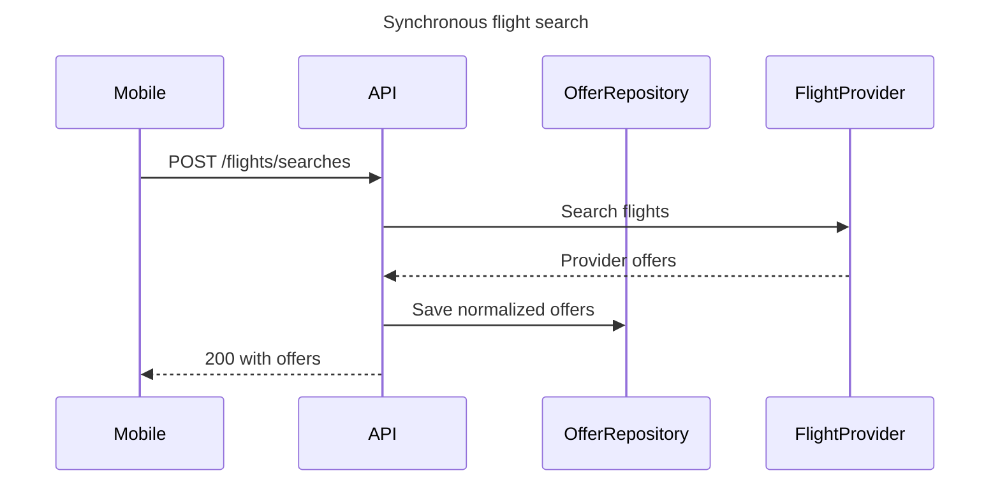

# Flight search module

The flight module implements synchronous provider-neutral flight search from
`docs/ttbooking-api.doc`. Its dependency direction is:

```text
mobile controller → application use case → FlightProviderPort
                                      ↘ MockFlightProvider | TtbookingFlightProvider
```

## API and orchestration

```text
POST /api/v1/flights/searches
GET  /api/v1/flights/offers/{offerId}
POST /api/v1/flights/offers/{offerId}/revalidate
GET  /api/v1/flights/offers/{offerId}/fare-rules
```

`SearchFlightsUseCase` validates input, awaits the configured provider,
normalizes and saves offers, and returns them in the same HTTP response. The
remaining use cases read an offer, revalidate it and fetch fare rules.
Controllers contain no orchestration.



Search validation requires at least one adult, no more than nine passengers,
infants not exceeding adults, different origin/destination codes, non-past
dates and chronologically ordered multi-city legs.

The search contract supports provider-side criteria (`directOnly`,
`cabinClass`, `preferredAirlines`) and backend post-processing filters:
`departureTimeFrom`/`departureTimeTo`, `arrivalTimeFrom`/`arrivalTimeTo`,
`maxStops`, `maxDurationMinutes`, `baggageRequired`, `minPrice` and `maxPrice`.
Time values use local `HH:mm`; a range whose start is later than its end wraps
across midnight. `sortBy` accepts `recommended`, `price`, `duration` or
`departure`. Recommended order preserves the provider ranking.

Normalized, filtered search results are cached in Redis for five minutes. The
key is a SHA-256 hash of canonical search parameters plus the provider name;
passenger groups and preferred airlines are sorted before hashing so equivalent
requests share a cache entry. Cache hits still receive fresh ProTravel offer
UUIDs that are saved for revalidation and booking. Redis failures are handled
as cache misses and do not make provider search unavailable.

Calendar dates are represented by `LocalDateValueObject`, backed internally by
`@js-temporal/polyfill` and `Temporal.PlainDate`. The application obtains
today's date through the injected `ApplicationClock` in `APP_TIME_ZONE`
(`Asia/Tashkent` by default); use cases do not construct JavaScript `Date`
objects or derive calendar dates by slicing UTC timestamps.

Each business validation has a stable error code:

- `FLIGHT_SEARCH_ADULT_REQUIRED`;
- `FLIGHT_SEARCH_INFANTS_EXCEED_ADULTS`;
- `FLIGHT_SEARCH_PASSENGER_LIMIT_EXCEEDED`;
- `FLIGHT_SEARCH_SAME_AIRPORT`;
- `FLIGHT_SEARCH_DATE_INVALID`;
- `FLIGHT_SEARCH_DATE_IN_PAST`;
- `FLIGHT_SEARCH_DATES_NOT_CHRONOLOGICAL`.

The global error filter translates these codes using `Accept-Language`. Safe
structured context such as `routeIndex` or total passenger count is returned
in `error.details` for mobile form handling.

TTBooking tokens exist only in the internal `FlightOffer.providerReference`.
Public consumers receive ProTravel UUIDs and never depend on a provider token.

## Providers

Local development defaults to the deterministic `mock` provider. TTBooking uses:

```dotenv
FLIGHT_PROVIDER=ttbooking
TTBOOKING_BASE_URL=https://provider.example/flight-api
TTBOOKING_FARE_RULES_URL=https://provider.example/readFlightRules
TTBOOKING_AGENCY_ID=...
TTBOOKING_USER_ID=...
TTBOOKING_PASSWORD=...
TTBOOKING_LOCALE=ru
TTBOOKING_TIMEOUT_MS=30000
TTBOOKING_DEFAULT_CURRENCY=RUB
TTBOOKING_AMOUNT_MULTIPLIER=1
```

`TtbookingFlightProvider` is the internal protocol adapter for TTBooking. It
maps `SEARCHFR`, `SELECTFR` and `readFlightRules` behind `FlightProviderPort`.
The signing implementation follows the supplied legacy document: MD5 of the
literal ordered string
`agency=<id>&password=<password hash>&time=<request time>&user=<id>`. The exact
same `time` value is sent in `context.time`. A real signing fixture must be
confirmed with the provider before production credentials are enabled.

The legacy response does not explicitly declare currency or minor-unit
semantics. `TTBOOKING_DEFAULT_CURRENCY` and `TTBOOKING_AMOUNT_MULTIPLIER` keep those
assumptions configurable. The public contract always returns an integer
minor-unit string and a currency enum.

TTBooking segment timestamps are local values without an offset and remain
`departureLocal`/`arrivalLocal`; they are not falsely marked as UTC. A TTBooking
`timeLimit` with an offset is normalized to ISO 8601.

Search departure dates are calendar values. TTBooking receives
`YYYY-MM-DDT00:00:00` without a fabricated offset. If the live provider
requires an offset, it must be calculated from the origin airport IANA time
zone for that departure date; a fixed `+05:00` is forbidden.

## Persistence and scaling

Flight search is a direct request/response operation and does not use BullMQ.
The application awaits TTBooking within the HTTP request and returns normalized
offers immediately. Gateway and provider timeouts must be longer than the
configured `TTBOOKING_TIMEOUT_MS`.

The search-result cache is shared through Redis. The offer repository itself is
still in memory and is intended for one local Nest process. Before multi-replica
Kubernetes or production, persist individual offers and private provider tokens
in Redis with an explicit TTL so subsequent revalidation and booking can run on
any backend pod.

Provider failures return responses with stable application codes. Precise
`PRICE_CHANGED`, `SOLD_OUT` and `OFFER_EXPIRED` mapping needs real TTBooking
response fixtures.

TTBooking transport failures are normalized by `TtbookingErrorMapper` before
they cross the provider boundary. The current stable codes are
`FLIGHT_PROVIDER_UNAVAILABLE`, `FLIGHT_PROVIDER_TIMEOUT`,
`FLIGHT_PROVIDER_RATE_LIMITED`, `FLIGHT_PROVIDER_AUTH_FAILED`,
`FLIGHT_OFFER_UNAVAILABLE` and `FLIGHT_BOOKING_FAILED`. The global HTTP filter
localizes their safe messages from `Accept-Language`; raw provider payloads,
URLs and transport messages are never returned to clients.
